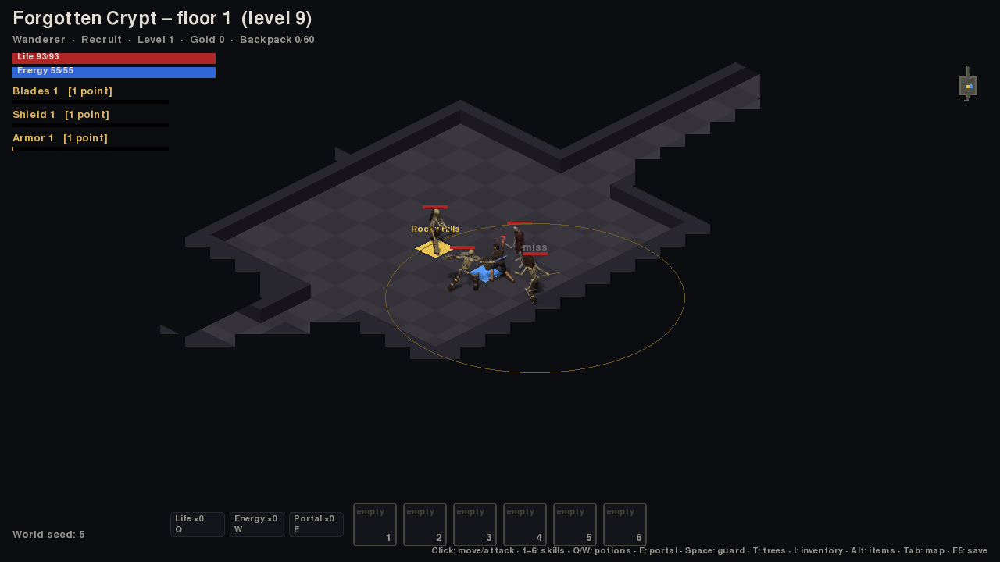

# Aethelgard

RPG de ação isométrico 2D, open source, feito em Python. **Não há classes**: o personagem
evolui nas proficiências que usa (Blades, Shield, Armor…). Mapas gerados por seed, monstros
em grupos normais, champions e únicos com minions, loot com afixos, guarda ativa com escudo e
tempos de ação (recarga de habilidades, recuperação de golpe e de bloqueio).

Status: **protótipo jogável (marcos M0–M2)**, com sprites animados de protótipo (arte do [Flare](https://github.com/flareteam/flare-game), CC-BY-SA 3.0) e formas simples onde ainda falta arte.



- Design completo: [`docs/GDD_Aethelgard_v0.4.docx`](docs/GDD_Aethelgard_v0.4.docx)
- Balanceamento: [`docs/Balanceamento_Aethelgard_v0.3.xlsx`](docs/Balanceamento_Aethelgard_v0.3.xlsx)
- Plano de trabalho: [`docs/BACKLOG.md`](docs/BACKLOG.md)
- Arquitetura: [`docs/ARQUITETURA.md`](docs/ARQUITETURA.md)

## Como jogar

Requisito: **Python 3.11 ou mais novo** (https://www.python.org/downloads/).

```bash
git clone https://github.com/SEU_USUARIO/aethelgard.git
cd aethelgard
python -m venv .venv
# Windows: .venv\Scripts\activate      Linux/macOS: source .venv/bin/activate
pip install -e ".[dev]"
aethelgard            # ou: python -m aethelgard
```

Opções: `--seed 42` (mundo fixo), `--area plains` (começar numa área), `--new` (personagem novo, ignora o save),
`--save-dir pasta` (onde guardar o save).

O jogo é todo em inglês. Ao reabrir, o personagem volta **na vila** com os mesmos níveis, pontos de
árvore, equipamento, mochila, ouro e poções; o mundo é gerado de novo (seed nova a cada jogo).

### Controles

| Ação | Tecla |
|---|---|
| Andar / atacar | Clique esquerdo no chão / no monstro |
| Guarda com escudo | Segurar **Espaço** (o escudo aponta para o mouse) |
| Habilidades | **Q** Precise Strike · **W** Shield Bash · **E** Wide Slash · **R** Bulwark |
| Gastar ponto de árvore | **1** Sharp Blade · **2** Precise Strike · **3** Defensive Stance · **4** Shield Bash · **5** Iron Skin · **6** Recovery · **7** Parry |
| Árvores de habilidade (janela) | **T** |
| Mapa grande | **Tab** (o mapa pequeno fica no canto) |
| Salvar | **F5** ou `save` no console (o jogo também salva ao sair) |
| Console de depuração | **F1** (digite `help`; `bag` lista mochila e equipamento, `load` recarrega o save) |
| Sair | Esc |

A névoa de guerra esconde o que você ainda não viu, e monstros fora do campo de visão não
aparecem. Saídas em amarelo, waypoint em azul. Champions são azuis, únicos dourados, minions marrons e
o chefe roxo. A barra de habilidades mostra a recarga de cada uma; o centro da tela mostra
recuperação de golpe, de bloqueio e atordoamento com o tempo restante.

## Save

Um arquivo JSON versionado por personagem, gravado com segurança (arquivo temporário + troca) e com
backup automático (`character.bak.json`), usado se o principal estiver corrompido:

| Sistema | Pasta |
|---|---|
| Windows | `%APPDATA%\Aethelgard\saves` |
| macOS | `~/Library/Application Support/Aethelgard/saves` |
| Linux | `~/.local/share/aethelgard/saves` |

A variável de ambiente `AETHELGARD_SAVE_DIR` ou a opção `--save-dir` trocam a pasta. Rodadas com
`--frames` (testes/CI) nunca gravam.

## Bibliotecas

| Biblioteca | Para quê | Licença |
|---|---|---|
| [pygame-ce](https://pyga.me) | janela, desenho, entrada, som | LGPL |
| [pygame_gui](https://github.com/MyreMylar/pygame_gui) | janelas e widgets (árvore de habilidades, console) | MIT |
| [numpy](https://numpy.org) | geração de mapas vetorizada | BSD |
| [python-tcod](https://github.com/libtcod/python-tcod) | A*, distâncias e campo de visão em C | BSD |
| [pytmx](https://github.com/bitcraft/pytmx) | mapas feitos à mão no editor [Tiled](https://www.mapeditor.org) | LGPL |
| pytest, ruff, PyInstaller | testes, padrão de código, executável | MIT/BSD/GPL |

## Editar mapas no Tiled

A vila (`src/aethelgard/data/maps/village.tmx`) é feita à mão no editor gratuito **Tiled**. O mapa
é lógico e ortogonal: cada tile é uma célula do jogo, e o jogo desenha em isométrico.
- Tiles do conjunto `logic.tsx`: chão e estrada (andáveis), parede e água (bloqueiam). A propriedade `walkable` decide.
- Camada de objetos `objects`: `entry` (chegada), `exit` (propriedade `target` = id da área),
  `waypoint` e `npc` (propriedade `role`: `vendor`, `stash`…).
- Para usar um mapa feito à mão em outra área, ponha `"map": "maps/arquivo.tmx"` em `areas.json`.

## Para desenvolver

```bash
pytest                                  # testes rápidos
pytest -m slow                          # 100 seeds por área (≈30 s)
ruff check src tests                    # padrão de código
python -m aethelgard.tools.simulate     # progressão do Ato 1 com os dados atuais
python -m aethelgard.tools.curves       # tabelas geradas pelas curvas
```

Regra de ouro: **regra de jogo vai em `aethelgard/core`, com teste, sem importar pygame.**
O cliente (`aethelgard/client`) só lê entrada, envia comandos ao mundo e desenha.
Números ficam em `src/aethelgard/data/*.json`. Veja [`CONTRIBUTING.md`](CONTRIBUTING.md).

```
src/aethelgard/
  core/     regras: dados, RNG, XP por uso, combate, guarda, tempos, monstros, loot,
            geração de mapas, A*, mundo em tempo real, sessão, simulação
  client/   pygame-ce: câmera isométrica, mapa, atores, HUD, console
  data/     todos os números do jogo (JSON)
  tools/    simulação e tabelas pela linha de comando
tests/      pytest
docs/       GDD, planilha, backlog, arquitetura
```

## Licença

- **Código:** [GPL-3.0-or-later](LICENSE). Você pode usar, estudar, modificar e redistribuir;
  versões modificadas precisam continuar abertas sob a mesma licença.
- **Arte de terceiros:** os sprites em `src/aethelgard/assets/sprites/flare` vêm do jogo livre
  [Flare](https://github.com/flareteam/flare-game) (Clint Bellanger, Justin Jacobs e colaboradores),
  sob **CC-BY-SA 3.0**, reduzidos e reempacotados (`ATTRIBUTION.md` na pasta). Cada arquivo está em
  [`docs/licencas_assets.csv`](docs/licencas_assets.csv). Para gerar de novo:
  `pip install -e ".[art]"` e `python -m aethelgard.tools.import_flare <checkout do flare-game>`.
- **Arte e som próprios:** ainda não há. Quando houver, terão licença própria (veja o backlog M8-07).
- O balanceamento usa o ritmo de ARPGs clássicos como referência, com curvas próprias por
  fórmula. Nenhuma tabela, nome, arte ou som dos jogos de referência (Diablo, Dungeon Siege) faz parte
  deste repositório; arte de terceiros só entra com licença livre que permita redistribuição.
